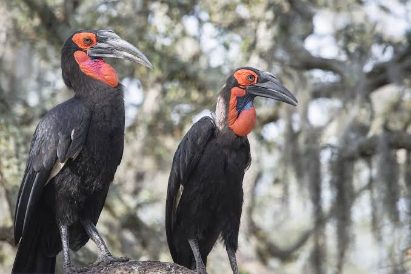

  My first blog! Although I'm not an expert birder, I find it so interesting how much birds vary around the world. Evolution and natural selection favors these winged egg laying creatures so much that there are over 11,000 species, and they can vary in weight from 0.07 ounces to 350 pounds (shoutout my boy ostrich). Needless to say, there's always something new to learn about birds, and I'm bringing you - most esteemed reader - some tidbits, facts, and personal opinions about birds to appreciate their uniqueness. I'm starting with one of my favorite birds, the Southern Ground Hornbill. They're one of my favorites because of their distinct red face and large beak, and because I was lucky enough to see one myself in Kruger National Park in South Africa. For whatever reason, I wanted to see these guys more than any other animal on our safari. So once we spotted a group of them foraging on our last day, my love for these scavengers exploded.
  The Southern Ground Hornbill is similar in size to a large wild turkey, and it's the largest hornbill species in the world. They have a set of powerful black wings, but they typically spend their days walking in groups across the savannah hunting small animals or using their massive bills to dig up roots and flip over objects. Their bills are the closest thing they have to a fork and knife, since they typically break apart their food before eating it. A bit more classy than seagulls who swallow their food whole. 
  Their distinctive red faces are more than just show, and are used to make calls and distinguish between males and females. The males have a completely red face, while females have a dark violet patch underneath their bills (take a look at the photo of our aura farming power couple). Their wattle underneath the bill is used to amplify their deep grunting calls for communication. The wattles inflate like a balloon, similar to a frog's croak.
  Family groups stay together for a long period of time. A group only lays about two eggs every nine years, and only one of them typically survives into adulthood. Once they reach adulthood, these birds can live up to 70 years in captivity, but even in captivity they aren't to be messed with. A child entered a Southern Ground Hornbill exhibit this past summer in Milwaukee, promptly getting chased out and swarmed by a group of the stressed out birds (nobody was injured). 
  The Southern Ground Hornbill is super unique - they live in groups, maneuver like predatory mammals, and utilize their characteristic bills in many different ways. Based on my experiences, they seem stoic; they carry themselves like they own the savannah (until a lion wants a delicious bird meal), and their old age comes with some type of bird wisdom that I wish I knew about. Thanks for reading.